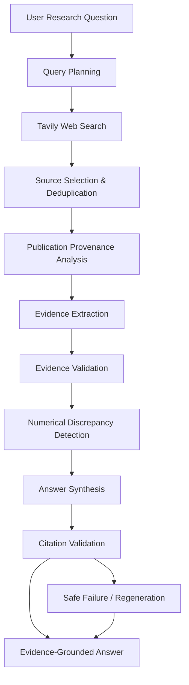

# VeriFAI — Evidence-Grounded Research Agent

> **Research you can verify.**

VeriFAI is an AI-powered research agent that transforms complex questions into evidence-grounded answers. It plans searches, retrieves information from the web, evaluates supporting evidence, tracks source provenance, identifies numerical discrepancies, and generates answers with traceable citations.

Built for the **ODSC × Nebius Hackathon**.

<p align="center">
  **Ask anything. Trace every claim. Trust only what the evidence supports.**
</p>

---

## Demo

- **Demo video:** [https://youtu.be/T0BdUKvjIqk]
- **live website:** [https://verifai-pakv.onrender.com/]
- **Repository:** [GitHub repository](https://github.com/AlilouTopG/nebius-sourced-researcher)
- **Team:** [Add team members and GitHub handles]

---

## The Problem

AI-generated research answers can sound convincing while relying on outdated information, repeated reporting, unsupported claims, or citations that do not actually support the answer.

Traditional search engines provide links, but users still have to manually compare sources, identify contradictions, and determine whether different articles represent independent evidence.

VeriFAI addresses this problem by treating research as an evidence-verification process rather than simply a text-generation task.

## The Solution

VeriFAI is designed to make AI-assisted research more transparent and auditable.

Instead of generating an answer directly from a question, it follows a structured research pipeline:

1. Understands the research question and plans targeted searches.
2. Retrieves relevant web sources using Tavily.
3. Selects and deduplicates retrieved sources.
4. Tracks publication provenance and source relationships.
5. Extracts claims and supporting evidence.
6. Validates evidence against retrieved sources.
7. Detects potential numerical discrepancies.
8. Synthesizes an answer with source-linked citations.
9. Validates citations before returning the final result.

When evidence is insufficient or citations cannot be validated, VeriFAI reports the limitation rather than presenting unsupported information as verified.

---

## How It Works



### Research Pipeline

| Stage | Responsibility |
|---|---|
| Query planning | Generates targeted search queries from the user's question. |
| Web retrieval | Uses Tavily to retrieve relevant, up-to-date web sources. |
| Source curation | Filters low-quality results, normalizes URLs, and removes duplicates. |
| Provenance analysis | Identifies publication relationships and distinguishes repeated reporting from distinct publications. |
| Evidence extraction | Extracts claims and their supporting source references. |
| Evidence validation | Checks whether extracted evidence is associated with available sources. |
| Conflict detection | Identifies numerical discrepancies while accounting for measurement context and publication relationships. |
| Answer synthesis | Generates a structured response using the validated evidence. |
| Citation validation | Rejects references that do not correspond to known sources and attempts a controlled regeneration. |

---

## Key Features

### 1. Evidence-Grounded Answers

Answers are built from retrieved sources rather than relying exclusively on the model's internal knowledge.

Claims are associated with source references so users can inspect the underlying evidence.

### 2. Publication Provenance Tracking

VeriFAI considers the relationship between publications when evaluating evidence.

It distinguishes between:

- **Same publication:** Multiple URLs or representations referring to the same underlying publication.
- **Distinct publications:** Explicit identifiers indicate different publications.
- **Unknown relationship:** Available metadata is insufficient to establish a relationship.

Importantly, different publications are not automatically treated as independent evidence. Publication identity and evidence independence are separate concepts.

### 3. Conservative Numerical Discrepancy Detection

VeriFAI identifies potential numerical discrepancies without automatically treating every difference as a contradiction.

It considers measurement context, including:

- Reporting periods
- Geographic scope
- Measurement units
- Aggregation levels
- Publication relationships

This helps avoid misleading conflict detection when two sources report different values for different contexts.

### 4. Citation Validation

The system validates generated citations against the sources actually retrieved.

It supports source references such as `[S1]` and `[S2]`.

Invalid references can trigger a controlled regeneration attempt. If validation still fails, the system reports the failure rather than silently presenting an unverified answer.

### 5. Safe Failure Handling

Research quality matters more than forcing an answer.

When useful sources cannot be found, evidence extraction fails, or citations remain invalid, VeriFAI exposes the limitation instead of pretending the research succeeded.

---

## Technology Stack

| Technology | Purpose |
|---|---|
| Python | Core application and research orchestration |
| FastAPI | HTTP API and application backend |
| Tavily | Real-time web search and source retrieval |
| OpenAI Python SDK | OpenAI-compatible LLM client |
| Pydantic | Structured data and validation |
| Pytest | Automated testing |
| Groq | Current development inference provider |
| Nebius Token Factory | Intended hackathon inference provider |

### Required Hackathon Services

**Tavily — Web Search**

Tavily powers the web retrieval stage. Search results are curated and passed into the evidence-processing pipeline, preserving source URLs and identifiers for downstream validation and citations.

**Nebius Token Factory — LLM Inference**

The application uses an OpenAI-compatible client architecture, allowing the inference provider to be configured through environment variables.

The current development environment uses Groq while Nebius Token Factory credentials are pending. A successful live Nebius inference test has not yet been confirmed.

The intended Nebius Token Factory endpoint is:

`https://api.tokenfactory.nebius.com/v1/`

The final submission should document the actual Nebius model used once integration has been completed and tested.

---

## Getting Started

### Prerequisites

- Python 3.10 or later
- Git
- Tavily API key
- API key for a supported OpenAI-compatible inference provider

### 1. Clone the Repository

```bash
git clone https://github.com/AlilouTopG/nebius-sourced-researcher.git
cd nebius-sourced-researcher
```

### 2. Create a Virtual Environment

**Windows PowerShell:**

```powershell
python -m venv .venv
.\.venv\Scripts\Activate.ps1
```

**Linux / macOS:**

```bash
python -m venv .venv
source .venv/bin/activate
```

### 3. Install Dependencies

```bash
pip install -r requirements.txt
```

### 4. Configure Environment Variables

Copy the example environment file:

**Windows PowerShell:**

```powershell
Copy-Item .env.example .env
```

**Linux / macOS:**

```bash
cp .env.example .env
```

Configure the required API credentials and model settings in `.env`.

Never commit `.env` or expose API keys publicly.

### 5. Run the Research Agent

```bash
python -m src.agent "What is Nebius Token Factory and how does its OpenAI-compatible API work?"
```

---

## Running the API

Start the FastAPI application:

```bash
python -m uvicorn src.server:app --reload
```

The application will be available at:

`http://127.0.0.1:8000`

### Available Endpoints

| Method | Endpoint | Description |
|---|---|---|
| GET | `/` | Serves the web interface. |
| GET | `/api/health` | Checks application and agent availability. |
| POST | `/api/research` | Executes a research request. |

### Example API Request

```powershell
Invoke-RestMethod `
  -Uri http://127.0.0.1:8000/api/research `
  -Method Post `
  -ContentType "application/json" `
  -Body '{"question":"What is Nebius Token Factory and how does its OpenAI-compatible API work?"}'
```

---

## Example Research

**Question:**

What is Nebius Token Factory and how does its OpenAI-compatible API work?

**Research process:**

- Generates targeted search queries.
- Retrieves relevant documentation and publications.
- Extracts claims and supporting evidence.
- Validates source references.
- Synthesizes an answer with citations.

**Example source references:**

- `[S1]` — Nebius Token Factory overview
- `[S2]` — Nebius Token Factory API documentation
- `[S3]` — Additional supporting publication

The final demo should include an actual successful application response, with the corresponding source URLs and citations.

---

## Failure Handling and Limitations

VeriFAI is designed to expose uncertainty and validation failures.

Examples include:

| Situation | Expected behavior |
|---|---|
| No useful search results | Returns an insufficient-evidence result. |
| Evidence extraction failure | Records the failure and avoids unsupported synthesis. |
| Incomplete evidence | Excludes claims that cannot be adequately supported. |
| Invalid citations | Attempts controlled regeneration and validates again. |
| Persistent citation failure | Returns a safe failure response with diagnostics. |
| Unclear publication relationship | Keeps the relationship unknown rather than assuming independence. |
| Numerical differences across measurement contexts | Avoids automatically classifying them as contradictions. |

**Limitations:**

- Research quality depends on the relevance and availability of retrieved web sources.
- Search results may contain outdated, incomplete, or conflicting information.
- Publication metadata may be insufficient to establish relationships.
- Citation validation verifies references against retrieved sources; it does not guarantee that every source is factually correct.
- Model-generated synthesis can still require human review.

---

## Testing

Run the automated test suite:

```bash
python -m pytest -q
```

**Verified test result:** 115 passed.

The test suite covers research pipeline behavior, evidence handling, provenance relationships, numerical discrepancy detection, citation validation, failure handling, and API integration.

---

## Hackathon Judging Criteria

| Criterion | Weight | Relevant implementation |
|---|---:|---|
| Sourced and verifiable answers | 30% | Evidence extraction, validation, provenance, and citation checks |
| End-to-end functionality | 25% | Query planning, Tavily retrieval, synthesis, API, and web interface |
| Usefulness | 20% | Research assistance with traceable claims and source references |
| Agent design | 15% | Structured orchestration, evidence processing, and conservative conflict detection |
| Nebius Token Factory and Tavily | 10% | Configurable inference architecture and Tavily retrieval; live Nebius integration must be demonstrated in the final submission |

---

## Team

- **[ALI NASREDDINE BENSEFFA]** — [Backend API / Frontend / Integration / Release / AlilouTopG]
- **[ALLALI SYRINE]** — [AI / Agent Engineering / syrineallali2-pixel]

---

## License

This project is licensed under the MIT License.
